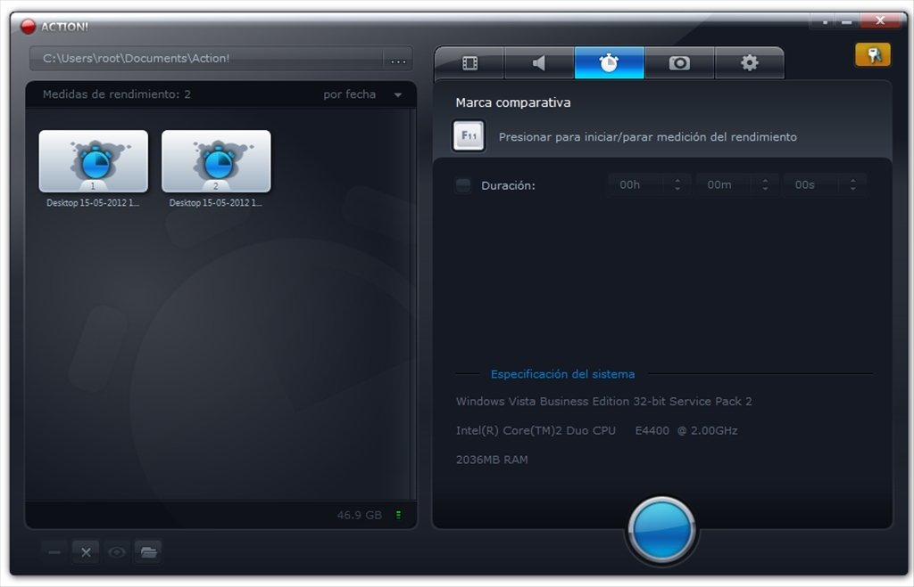
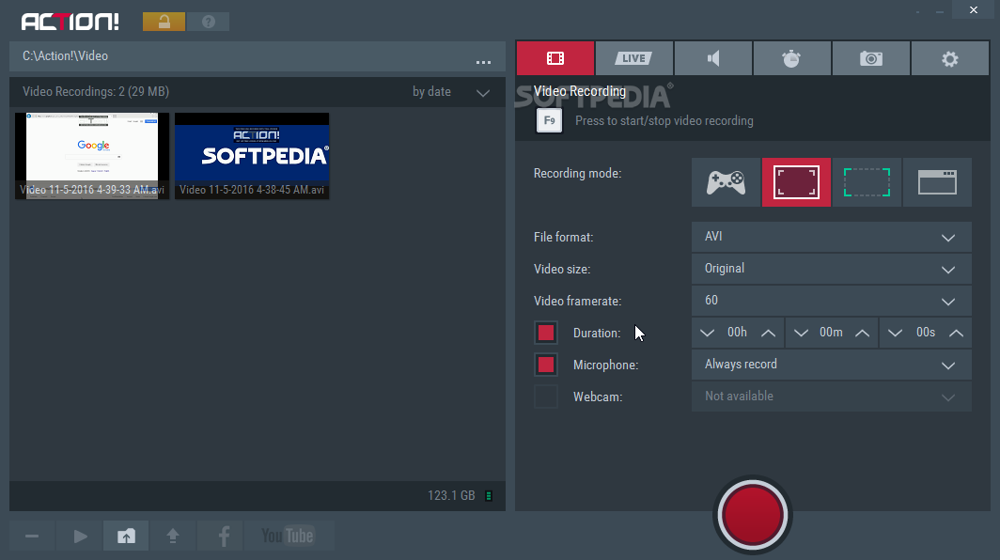

# Action! for Windows Gameplay and Screen Recording

Mirillis Action! records gameplay, desktop activity, and selected applications on Windows.
Combine video capture with system audio, microphone commentary, and a webcam.

[](https://github.com/karenper-1569/mirillis-action/releases/)

Use mirillis action for a focused recording or a live presentation.
Choose the capture source and output settings to match the session.

## Capture Modes

Different recording tasks need different capture boundaries.
Select the mode that shows the content you intend to record.

- Games and applications capture.
- Active-screen recording.
- Selected desktop-region recording.
- Selected-application recording.
- Webcam and supported capture-device recording.
- Screenshot capture.
- Time-Shift recording for supported modes.
- Desktop and gameplay live streaming.

The Mirillis Action screen recorder includes controls for both video and audio.
Screen capture and live streaming have separate settings to review.

## Choosing a Recording Source

Use a short test to confirm that the selected mode captures the intended content.
Keep source selection separate from video quality decisions.

| Recording task | Source to consider | What to verify |
|---|---|---|
| Game footage | Game or application capture | The intended game is detected |
| Desktop demonstration | Active screen | The correct display is selected |
| Focused tutorial | Desktop region | The required controls fit inside the region |
| One application | Selected application | The intended window appears in preview |
| External video source | Supported capture device | Input signal and device settings are correct |

The Mirillis Action game recorder can also add commentary and webcam video.
Test the combined result rather than checking each source in isolation.



## Recording Quality and Formats

Select resolution and frame rate with the target content in mind.
Fast gameplay and a mostly static desktop demonstration have different demands.

Action! records AVI using the Mirillis FICV codec.
MP4 recording uses H.264/AVC or H.265/HEVC.

| Output choice | Useful consideration |
|---|---|
| AVI with FICV | Confirm playback and editing support for the codec |
| MP4 with H.264 | Check compatibility with the destination player or editor |
| MP4 with HEVC | Confirm decoding support on the receiving system |
| Higher resolution | Allow additional processing and storage capacity |
| Higher frame rate | Check whether the recording remains smooth under load |

Action! 4K recording depends on the selected format, source, and hardware.
The Mirillis Action 4K screen recorder settings should be tested with your actual workload.

Hardware encoding availability depends on the graphics hardware and driver.
A higher setting is useful only when the resulting recording is reliable.

## Audio and Webcam Layers

System sound and microphone commentary serve different roles.
Check their relative levels before recording an extended session.

- Select the intended system-audio source.
- Choose the microphone you want to record.
- Adjust microphone volume and mixing level.
- Use a separate microphone track where the selected options support it.
- Position the webcam so it does not cover important content.
- Check overlays against both bright and dark scenes.

Headphones can help prevent speaker output from entering the microphone.
Listen to a saved test recording to confirm the actual captured balance.

## A Repeatable Recording Session

Keep the same verification sequence when switching between games or applications.
A saved file is the final check that the whole recording path works.

1. Select the capture mode and intended source.
2. Confirm the recording folder and available disk space.
3. Choose the file format, resolution, and frame rate.
4. Review system sound, microphone, webcam, and overlays.
5. Check the configured hotkeys for conflicts.
6. Record a short sample and play it back.
7. Begin the full session once the sample matches your requirements.

The HUD provides recording feedback while you work.
Use its state indicators to distinguish active recording from an idle capture session.

## Checking Available Storage

Windows PowerShell can display free space on filesystem drives.
This example reads system information and does not change Action! settings.

```powershell
Get-PSDrive -PSProvider FileSystem |
    Select-Object Name,
        @{Name='FreeGiB'; Expression={[math]::Round($_.Free / 1GB, 1)}}
```

Compare the result with the drive used by your configured recording folder.
Leave enough capacity for the expected session and subsequent export.

## Time-Shift and Hotkeys

Time-Shift keeps a rolling recording buffer for saving recent activity.
Its behavior and available options depend on the capture mode.

Recent Action! releases support Time-Shift in selected-window and device modes.
Check the buffer settings before an event you want to preserve.

Hotkeys reduce the need to bring the recorder window into the foreground.
Choose combinations that do not collide with the application being recorded.

- Review recording and streaming controls.
- Check any assigned screenshot action.
- Confirm webcam and overlay controls you plan to use.
- Verify the shortcut in the actual game or application.

## Reviewing and Exporting Recordings

The recordings manager provides access to captured files.
Use playback to check the beginning, ending, and sound before exporting.

- Preview the selected recording.
- Open its output folder.
- Choose export settings appropriate to the destination.
- Keep the original until the exported copy has been checked.
- Review account and privacy selections when using an upload workflow.

Export and upload are separate from capture.
A successful recording does not confirm that a remote upload has completed.



## Inspecting Saved Files

This Windows PowerShell example lists recent video files in a folder you choose.
The example directory is a placeholder, not an Action! default.

```powershell
$recordingFolder = 'D:\Recordings'
Get-ChildItem -LiteralPath $recordingFolder -File |
    Where-Object { $_.Extension -in '.mp4', '.avi', '.mts' } |
    Sort-Object LastWriteTime -Descending |
    Select-Object -First 10 Name, Length, LastWriteTime
```

Adjust the folder to your configured destination before using the example.
File size and modification time help locate recordings; playback confirms their content.

## Live Streaming

Streaming requires a configured destination and an internet connection.
Verify the account or custom streaming settings before going live.

Check video, system audio, and microphone commentary in the streaming preview.
Use output settings that suit both the connection and the destination service.

Account authentication can change independently of local recording.
Action! 4.48.1 specifically fixes Twitch login through Account Manager.

## Compatibility and Feedback

Action! is a Windows application.
Recording modes, encoding options, and device support depend on the system configuration.

If capture fails, note the mode, graphics hardware, driver, and recorded application.
For device capture, include the exact device model and input settings.

A useful support report includes:

- The Action! version and Windows version.
- The selected capture mode.
- Graphics hardware and driver information.
- Resolution, frame rate, codec, and container.
- The steps that reproduce the problem.
- Whether a short test recording shows the same behavior.

Use Mirillis support channels for product issues and feature requests.
Include the specific session details needed to distinguish capture, audio, and upload problems.

## Related Search Terms

mirillis action, Mirillis Action screen recorder, Action! 4K, Mirillis Action game recorder, Mirillis Action 4K screen recorder, screen-recorder, game-capture, game-recording, video-recording, live-streaming, screen-capture, region-capture, screenshot, webcam, windows
